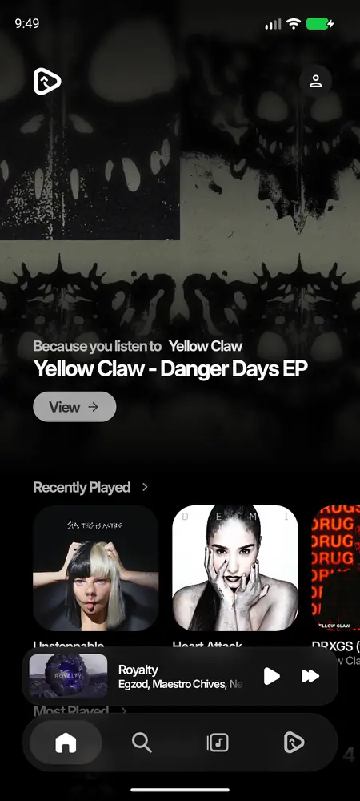
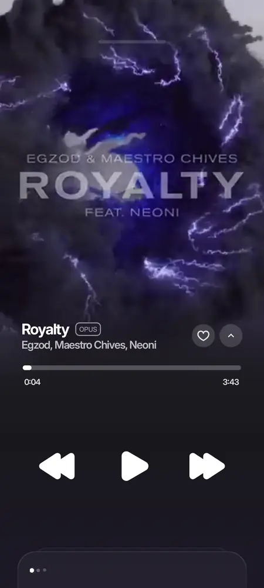
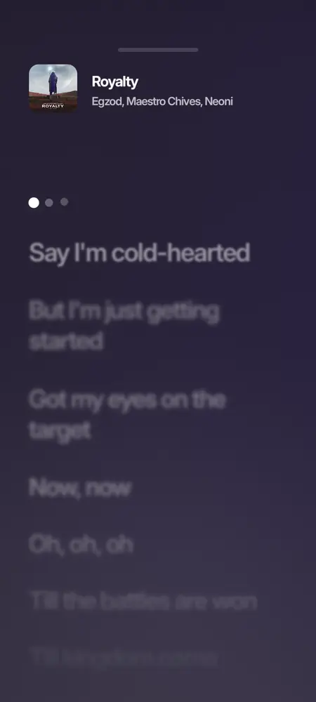
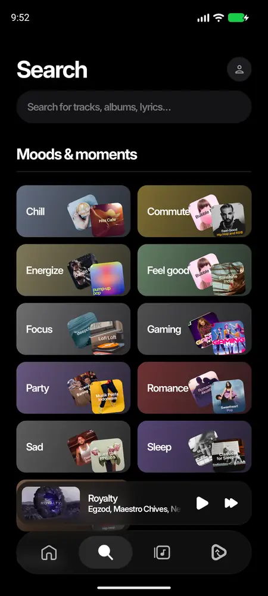
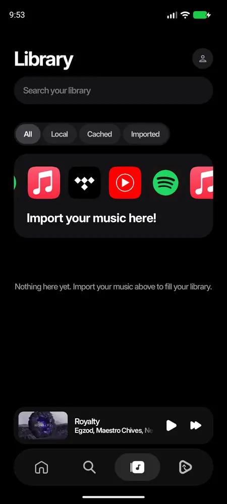
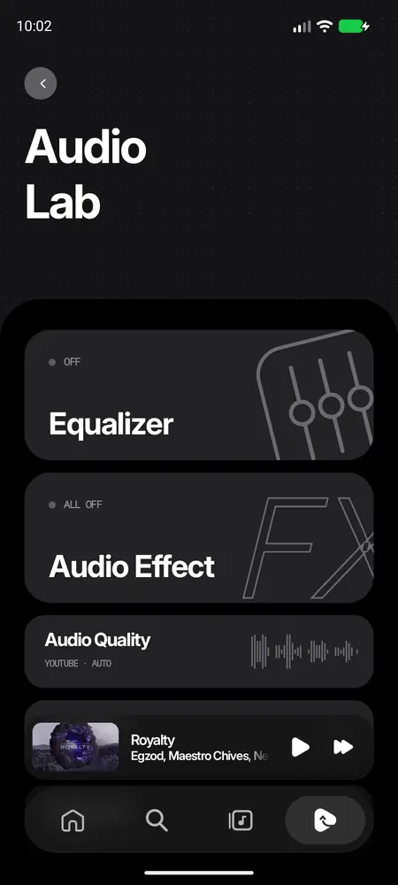
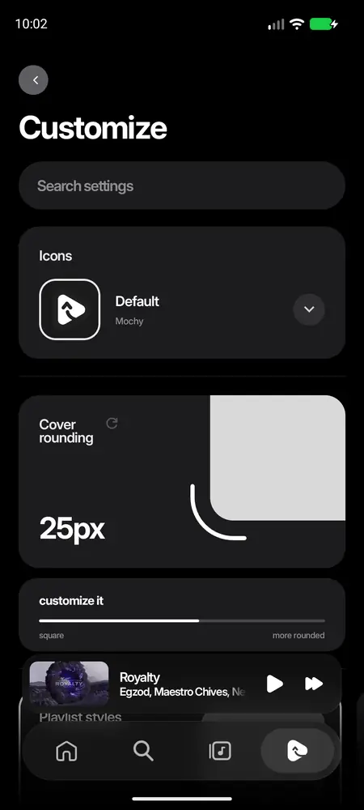
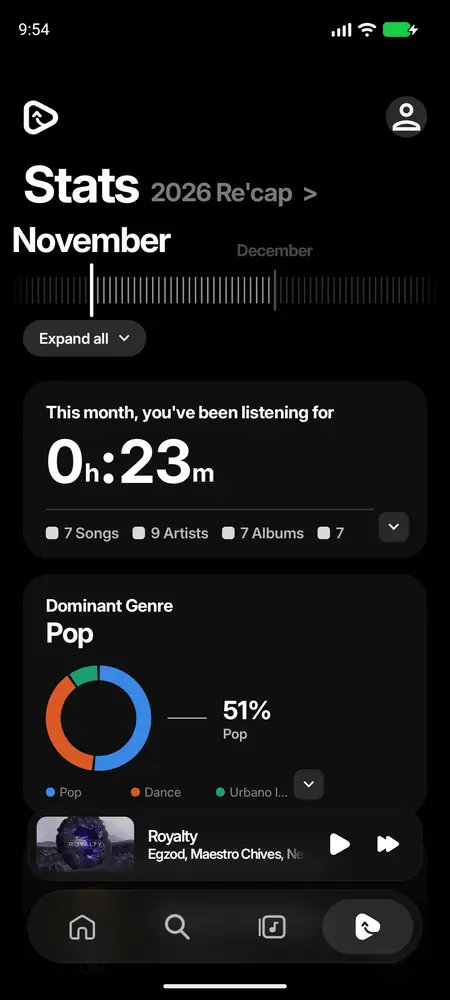
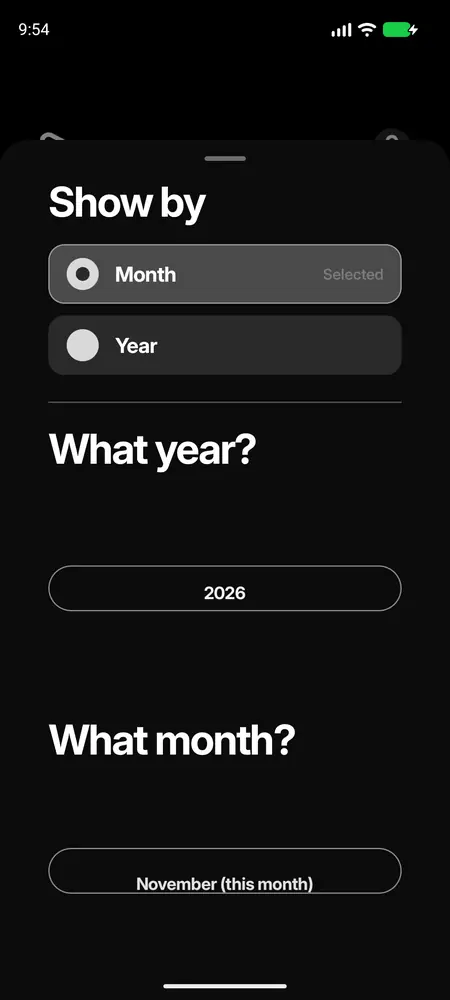

<div align="center">


# Kiyo · 清

🌸 <sub>きよ · 澄んだ音、静かな時間</sub> 🌸

**a sleek, modern music player for Android.**
open source, packed with features, and it doesn't collect your data.

<sub>version **5.6.0** · still in beta, so please expect a few bugs :)</sub>

<br/>

<p align="center">

<a href="https://github.com/zychohehe/Mochy-Music/releases">
    
</a>
  <a href="https://github.com/zychohehe/Mochy-Music/stargazers">
    
  </a>
  <a href="https://github.com/zychohehe/Mochy-Music/network/members">
    
      <a href="https://github.com/zychohehe/Mochy-Music/releases">
    
  </a>
  <a href="https://github.com/zychohehe/Mochy-Music/releases/latest">
    
  </a>
  <a href="https://www.figma.com/board/NWTElXRZ21LaaJotjuOe8D/Untitled?node-id=0-1&t=bMsq80RJXYybjXsh-1">
    
  </a>
  <a href="https://whatsapp.com/channel/0029Vb8gHJ7545uuF9Ox1I2z">
  
</a>

</a>
</p>

<br/>

[**Install**](#install) &nbsp;·&nbsp; [**What's new**](#whats-new-in-kiyo-560) &nbsp;·&nbsp; [**Features**](#features) &nbsp;·&nbsp; [**Preview**](#preview) &nbsp;·&nbsp; [**FAQ**](#faq) &nbsp;·&nbsp; [**Build**](#build-it-yourself)

</div>

> [!WARNING]
> Kiyo is still in beta, expect some bugs. Reporting them is super useful!

---

## What's new in Kiyo 5.6.0

<sub>New look · Los Angeles</sub>

- **Golden Hour design.** A new West Coast look: warm asphalt-black surfaces, a sunset coral accent, and pink, gold and palm-teal as supporting colours.
- **Warmer text.** Cream white and warm grey text instead of cold grey, so lyrics and titles feel softer at night.
- **Rounder shapes.** Cards, sheets and buttons use bigger corner radii.
- **Warm backgrounds.** The search screen and the default player background follow the same warm palette.
- **One place to tune it.** Every colour lives in `DesignTokens.kt`, so the whole look can be changed from one file.

---

## What's new in Kiyo 5.5.0

<sub>新着 · shinchaku</sub>

- **A new name.** The app is now **Kiyo**, renamed everywhere you can see it.
- **Japanese vibes.** A vermilion (朱色) icon with the white **K** stamp, and a little Japanese in the welcome line.
- **A new logo.** A clean **K** mark, used for the launcher icon, themed icon, splash screen, navigation and notifications.
- **A new package id.** Kiyo installs as `com.kiyo.music`, so it sits next to the old app as a separate install.
- **A cleaner profile.** The developer card now just says *developer*, with a fresh avatar.
- **Plain version numbers.** Versions show only the number (like `5.5.0`), without the `build` text.
- **Smoother scrolling.** Lists and grids across the app share one glide-style fling, so a flick coasts further and eases out evenly. The feel is tuned by a single value, `GlideFriction`.

> [!NOTE]
> Because the package id changed, Kiyo does not share data with the old app. Make a backup in the old app first if you want to move your library.

---

## Features

<sub>機能 · kinou</sub>

| | |
|---|---|
| 🎧 **Great sound** | Equalizer, Audio Lab and lossless-friendly playback options |
| 🎤 **Synced lyrics** | Line and word-timed lyrics from several providers |
| 🧩 **Modules** | Add new sources, skins, players and pages with modules |
| 🔁 **Import** | Bring playlists over from YouTube Music, Spotify, Apple Music and Tidal |
| 💬 **Discord status** | Show what you are listening to |
| 📊 **Stats and recap** | See what you listened to over time |
| 🎨 **Make it yours** | Home styles, player styles, animation speed, blur and more |
| 📺 **More screens** | Android TV, Android Auto and casting |
| 🔒 **Private** | No account needed, no tracking, GPL-3.0 open source |

---

## Install

<sub>インストール</sub>

1. On your phone, open the [latest release](https://github.com/zychohehe/Mochy-Music/releases/latest).
2. Download the `.apk` that matches your phone. Not sure? Pick **arm64**, that is almost every phone from the last 8 years. The **universal** one works everywhere but is bigger.
3. Open the downloaded file. Android will ask you to allow installs from your browser or file manager, say yes (you can turn it off again after).
4. Open Kiyo. You are done, no account needed to start listening.

Updating works the same way: install the new apk over the old one and your library stays.

> [!TIP]
> Only download Kiyo from the releases page of this repo. A random mediafire or telegram link could be a modified app, and then your logins would not be safe, pls avoid those.

> [!NOTE]
> Android 7 is supported unofficially.

---

## Preview

<sub>プレビュー</sub>

<table>
  <tr>
    <td align="center"><br/><sub>Home</sub></td>
    <td align="center"><br/><sub>Player</sub></td>
    <td align="center"><br/><sub>Lyrics</sub></td>
  </tr>
  <tr>
    <td align="center"><br/><sub>Search</sub></td>
    <td align="center"><br/><sub>Library</sub></td>
    <td align="center"><br/><sub>Audio Lab</sub></td>
  </tr>
  <tr>
    <td align="center"><br/><sub>Customisation</sub></td>
    <td align="center"><br/><sub>Stats</sub></td>
    <td align="center"><br/><sub>Recap</sub></td>
  </tr>
</table>

<details>
<summary>More screenshots</summary>
<br/>


</details>

---

## FAQ

<sub>よくある質問</sub>

<details>
<summary><b>Is it safe to log in?</b> (read this before signing in)</summary>
<br/>

You never have to log in to use Kiyo. Search, play, lyrics and downloads work without an account. Signing in is only for syncing your YouTube Music library, importing playlists from Spotify / Apple Music / Tidal, and Discord status.

**How the sign-in works**
- Kiyo opens the real login page of the service (for example accounts.google.com or open.spotify.com) inside the app. You type your password into **their** page, not into a Kiyo form.
- After you log in, the app keeps the session token or cookie that the service gives out, so you stay signed in. Your password is not what gets saved.
- That session stays on your phone, in the app's private storage. Kiyo has no account system of its own and does not run a server that collects logins.
- The tokens are meant to be used only to talk to the service you signed in to (for example Spotify's own site to read your playlists).
- The app is open source under GPL-3.0, so you do not have to take my word for it, you can read exactly what it does with them :)

</details>

<details>
<summary><b>Can you add liquid glass?</b></summary>
<br/>

Not now. Maybe as a module made by someone in the future.

</details>

<details>
<summary><b>Monochrome / flac stream doesn't work</b></summary>
<br/>

The server is down, it's on their side, not ours. Use another available source and join our WhatsApp channel.

</details>

<details>
<summary><b>The animation is too slow, can you speed it up?</b></summary>
<br/>

You can speed it up on the customise page.

</details>

<details>
<summary><b>The app is laggy, how do I fix it?</b></summary>
<br/>

Turning off blur helps.

</details>

<details>
<summary><b>Can you add less spacing for the player?</b></summary>
<br/>

You can customise it yourself.

</details>

<details>
<summary><b>Is there an official desktop app?</b></summary>
<br/>

Later.

</details>

<details>
<summary><b>Can I contribute?</b></summary>
<br/>

Of course! See [CONTRIBUTING](.github/CONTRIBUTING.md).

</details>

---

## Build it yourself

You only need this if you want to change the code. If you just want to use the app, use the install steps above.

### What you need

- A Mac, Linux or Windows computer
- [Android Studio](https://developer.android.com/studio) (latest stable). It brings JDK 21 and the Android SDK with it
- Android SDK 36 and NDK `27.0.12077973`. Android Studio offers to download both the first time you open the project
- About 10 GB of free disk space, the first build downloads a lot
- A phone with USB debugging on, or an emulator

### Steps

```bash
git clone https://github.com/zychohehe/Mochy-Music.git
cd Mochy-Music
```

1. Open the folder in Android Studio once and let it finish syncing. This also creates `local.properties` with your SDK path.
2. Build and install on your connected phone:
   ```bash
   ./build.sh --debug -i
   ```
   The first build takes a while, the next ones are much faster.
3. Or build the apk only and install it by hand. The apk lands in `apk-generated/`:
   ```bash
   ./build.sh --debug
   adb install -r apk-generated/*-debug.apk
   ```

Handy options (see `./build.sh --help` for all of them):

| Command | What it does |
|---|---|
| `./build.sh --debug -i` | debug build, installs and opens it on your phone |
| `./build.sh --release -cc` | release build for arm64 and universal |
| `./build.sh -fd --release` | F-Droid flavor, without the self-update permission |
| `./build.sh -k` | stops stuck Gradle builds |

Use **debug** while you are playing around, it builds much faster. A debug build installs next to the real app (`com.kiyo.music.debug`), so it will not touch your normal install, but it is a bit slower to run.

### Optional keys

Kiyo builds fine without these, only the matching feature is switched off. Put them in `local.properties` (it is never committed):

```properties
LASTFM_API_KEY=...
LASTFM_SECRET=...
DISCORD_CLIENT_ID=...
```

Never commit your keys. Libre.fm works without any key.

### If the build fails

- `Unresolved reference` or Hilt errors that make no sense: delete the `build/` folders and `.gradle/`, then build again.
- Stuck or weird Gradle: `./build.sh -k`, then try again.
- Wrong Java: make sure Gradle uses JDK 21 (Android Studio → Settings → Build Tools → Gradle → Gradle JDK).
- Still stuck? Open an [issue](https://github.com/zychohehe/Mochy-Music/issues) with the error text.

Want to send a fix? Read [CONTRIBUTING](.github/CONTRIBUTING.md) first.

### Modules

A guide for building modules is on its way.

---

## Help and bug reports

Found a bug or have an idea? Open an [issue](https://github.com/zychohehe/Mochy-Music/issues), and check [CONTRIBUTING](.github/CONTRIBUTING.md) first.

---

## Disclaimer

Kiyo is an independent, unofficial project made for personal and educational use. It is provided as is, without warranty of any kind.

- Kiyo is a fully open source project that is created purely for educationa and personal use. thats why, we dont sell this software, or monetize it. we do not have any intent to add commercial values in the future. thanks!
- And were deeply respect the hardwork of artist musicians ajd contwnt creators. without them there is also no kiyo: i strongly suggest that you, as user, subscribe to Apple music or youtube premium, to support the creators you listen. I do not intend to hurt creator with this app.
- It is **not affiliated with, endorsed by, or sponsored by** YouTube, YouTube Music, Google, Spotify, Apple, Last.fm, Shazam, Discord or any other service it can connect to. All names, logos and brands belong to their respective owners.
- Kiyo does not host, store or distribute any music. Everything is fetched from third-party services when you ask for it, and those services can change or stop working at any time.
- You are responsible for how you use the app, including the terms of service of the accounts and services you connect and the copyright laws where you live.
- Importing from other services (Spotify, etc.) uses your own account. Don't share your login data or tokens with anyone.
- Importing music MAY need your own account with its password. WE'RE NEVER see your password.

---

<!-- mochy-credit:start · f208ad37 -->
## Forking Mochy

Forks are welcome, that's what open source is for! Just two asks:

- **Keep the credit.** If you rename it, please keep credits of this app, the other project that helped mochy possible.
- **Keep it free.** Mochy is not monetized and never will be. Please don't put features behind a paywall. A donation page is fine.

<!-- mochy-credit:end -->

---

## These incredible project helped kiyo a lot! check them out too :3

- **ViviMusic** by [vivizzz007Z](https://github.com/vivizzz007Z) )[Their repo](https://github.com/vivizzz007/vivi-music)) -- For the base app. This app is a fork from this project.
- **Metrolist** by [Mostafa Alagamy](https://github.com/mostafaalagamy) ([Repository](https://github.com/mostafaalagamy/Metrolist)) -- For the base framework.
- **SimpMusic** by [maxrave-dev](https://github.com/maxrave-dev) ([Repository](https://github.com/maxrave-dev/SimpMusic)) -- For the lyrics API provider.
- **Archivetune** by [Rukamori](https://github.com/rukamori) ([Repository](https://github.com/rukamori/ArchiveTune)) -- For design and architectural inspiration.
- **RiMusic / InnerTube** by [fast4x](https://github.com/fast4x) ([Repository](https://github.com/fast4x/RiMusic)) -- For YouTube Music InnerTube API service wrapper.
- **LRCLib** by [tranxuanthang](https://github.com/tranxuanthang) ([Repository](https://github.com/tranxuanthang/lrclib) / [Website](https://lrclib.net/)) -- For synchronized LRC lyrics provider integration.
- **Monochrome Music** by [monochrome-music](https://github.com/monochrome-music) ([Repository](https://github.com/monochrome-music/monochrome) / ([Website](https://monochrome.st)) -- Flac streams, visit their web, very cool one.
- **Auto Eq** ([Web](https://autoeq.app)) -- The equalizer database
- **lrc.red** ([Web](https://lrc.red)) -- Word-timed lyrics for millions of songs, free for everyone
- **InnertubeX** by [nyxireal](https://github.com/nyxiereal) [Their repo](https://github.com/metrolistGroup/innertubex) For The Youtube API Access
- **Beatcord** (formerly BitChord) by [kushagrasinghx](https://github.com/kushagrasinghx/BitChord) -- The lyrics sources in `providers/beatlyrics` were taken from this project (GPL-3.0)

---

## Open source APIs kiyo talks to!!

These are the open source apis and server we get gets its lyrics, streams and data from. They r free for everyone because of these good people, so go give them a star!

- **LyricsPlus** by [Ibra Al Tabian](https://github.com/ibratabian17) ([repos](https://github.com/ibratabian17/LyricsPlus)) s
- **Better Lyrics API** by [Boidushya](https://github.com/boidushya) ([repos](https://github.com/better-lyrics/api)) 
- **LRCLIB** by [tranxuanthang](https://github.com/tranxuanthang) ([repos](https://github.com/tranxuanthang/lrclib) / [Website](https://lrclib.net/)) 
- **SimpMusic Lyrics** by [maxrave-dev](https://github.com/maxrave-dev) ([repos](https://github.com/maxrave-dev/SimpMusic)) 

---

## Developer & community

- **Developer:** [zychohehe](https://github.com/zychohehe)
- **Community:** [WhatsApp Channel](https://whatsapp.com/channel/0029Vb8gHJ7545uuF9Ox1I2z)

This build is a fork of [Mochy Music](https://github.com/realidkroo/Mochy-Music) by realidkroo (GPL-3.0), which is itself built on Vivimusic, Metrolist and others. The original authors stay credited in the app (About > Credits) and in the LICENSE.

## Releases

Every push to `main` builds a signed release APK and publishes it on the [Releases page](https://github.com/zychohehe/Mochy-Music/releases) automatically. See `.github/workflows/release.yml`.

---
## Star History

<a href="https://www.star-history.com/?repos=zychohehe%2FMochy-Music&type=date&legend=top-left">
 <picture>
   <source media="(prefers-color-scheme: dark)" srcset="https://api.star-history.com/chart?repos=zychohehe/Mochy-Music&type=date&theme=dark&legend=top-left" />
   <source media="(prefers-color-scheme: light)" srcset="https://api.star-history.com/chart?repos=zychohehe/Mochy-Music&type=date&legend=top-left" />
   
 </picture>
</a>

<div align="center">
  <sub>star the repo plssss apreciate it!!!!!</sub>
</div>

